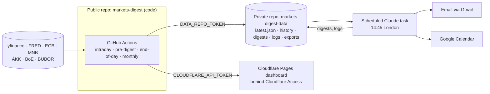

# markets-digest

A daily markets and economy briefing for a handful of readers: an email at 14:45 UK time and a private live dashboard. It covers US, UK, Hungarian, eurozone and Asian markets: 54 instruments (52 with a free source) across equities, FX, government bonds, credit, commodities and volatility, plus SPY and QQQ options.

Everything runs in the cloud on free tiers. **The code is public; the content is private.** This repo holds only code. Prices, digests, logs and exports live in a separate private repo, and the dashboard sits behind a login.

## What it does

- **Every 5 minutes on weekdays (07:00–21:00 UTC)** a GitHub Actions job fetches prices, recalculates the indicators and redeploys the dashboard.
- **At 14:35 London** it writes the morning's data (`latest.json`) to the private repo.
- **At 14:45 London** a scheduled Claude task reads that file and the last five digests, searches the news, writes the digest in its own words, checks every number against the data, and emails it (readers in BCC). It also keeps an "Econ Deadlines" Google Calendar up to date.
- **At the end of each day** it saves a dated snapshot and appends closing prices to a history file. Weekend digests read those files: a short note on Saturday, a weekly recap and long-read on Sunday.
- **On the 1st of each month** it exports the month to an Excel workbook, a PDF, a Word file and a private Google Sheet.

For each instrument it calculates: last price and its time, market state (open / closed / pre-market / after-hours), daily change (in basis points for yields), 50- and 200-day moving averages and crossings, distance from the 52-week high and low, and 20-day realised volatility. For options: at-the-money implied volatility, put/call ratios by volume and open interest, the largest open-interest strikes, and the next expiries.

## Architecture



| Part | Where it lives | Who can see it |
| --- | --- | --- |
| Code and workflows | This repo | Anyone |
| Data, digest archive, logs, exports | Private GitHub repo | The owner and the digest task |
| Live dashboard | Cloudflare Pages + Cloudflare Access (email one-time PIN) | The readers only |
| Digest writer | Scheduled task in the Claude app | The readers, by email |

```
config/instruments.toml   every instrument: name, group, source symbol, fallback, chart link
pipeline/                 fetch.py, indicators.py, options.py, run.py, export.py, ... (one job each)
tests/                    82 unittest tests; indicator maths checked against hand-worked numbers
site/                     the dashboard: static HTML, plain JavaScript, uPlot stored in the repo
templates/email.html      the email layout (tables and inline styles, so it works in Gmail and Outlook)
prompts/daily_digest.md   the instructions the scheduled task follows every day
docs/LEARNING.md          every finance and coding concept used, with examples from the data
.github/workflows/        the five scheduled jobs
```

Dependencies are kept short and pinned in `requirements.txt`: yfinance, pandas, requests, openpyxl, xlrd, python-docx and google-auth. No web framework, no build step.

## Dashboard

<!-- Screenshot added once taken from a logged-in reader's browser and checked for private details. -->

Grouped tables like the email, a price chart per instrument with its 50- and 200-day moving averages, the options block, and TradingView widgets for live prices beside our own numbers. Every number shows its source and time; values that fail the sanity checks are shown with a warning instead of being published silently.

## Sample digest

*Made-up example content, to show the format. Not a real digest, and not real market data.*

> **Markets Digest · Tuesday 3 March 2026** · 6 min read
> *Today in one sentence: a softer US jobs report lifts bonds, while the forint holds firm ahead of the MNB.*
>
> **Top 5**
> 1. US payrolls rose by less than expected; the 10-year yield fell 8 bp in early trading. [1]
> 2. The MNB meets today; markets expect rates to stay on hold. [2]
> 3. DAX 0.6% higher on a strong German factory orders print. [3]
> 4. Brent 1.9% lower after OPEC+ signalled more supply from April. [4]
> 5. OTP reports results on Thursday.
>
> **Market dashboard** (14:35 London; US open for 5 minutes)
>
> | | Level | Day | vs 50d / 200d |
> | --- | ---: | ---: | :---: |
> | S&P 500 *(open)* | 6,412.30 | ▲ 0.40% | above / above |
> | FTSE 100 *(open)* | 9,105.20 | ▼ 0.15% | above / above |
> | BUX *(open)* | 98,240.00 | ▲ 0.85% | above / above |
> | EUR/HUF | 391.80 | ▼ 0.20% | below / below |
> | US 10-year | 4.02% | ▼ 8 bp | below / below |
>
> **Hungary and CEE.** The forint firmed slightly before today's MNB decision, ... [2]
>
> **Learning corner.** *Basis point:* one hundredth of a percentage point. A yield moving from 4.10% to 4.02% has fallen 8 bp.
>
> Sources: [1] BLS · [2] MNB · [3] Destatis · [4] OPEC
>
> *For information only, not investment advice. Private: please do not forward.*

## Security and privacy

- **Code public, content private.** No data, digests, secrets or email addresses ever enter this repo; the local data folder is in `.gitignore`. Recipient addresses live only in the scheduled task and the Cloudflare Access policy.
- **GitHub account and workflows.** Two-factor authentication; every workflow has minimal `permissions:` (read-only, except the monthly keep-alive); every third-party action is pinned to a full commit SHA; **no workflow runs on pull requests**, so outside code can never reach the secrets; approval required for all outside contributors; Actions switched off in the data repo; `main` protected against force-push and deletion; Dependabot, secret scanning and push protection on.
- **Narrow, expiring tokens.** `DATA_REPO_TOKEN` can read and write the private repo's contents and nothing else. The Cloudflare token can only edit Pages. The Google service account has the Sheets scope only (no Drive) and can reach only the one Sheet shared with it.
- **Private dashboard.** Static files only (no server code, no database, no forms), so there is nothing to inject into. Cloudflare Access asks for an emailed one-time code on the production address, every preview address and the data files. Checked from outside the login: all three redirect to the code page.
- **Third-party code on the page.** The chart library is stored in the repo at a pinned version (no CDN); TradingView runs only in iframes. A strict Content Security Policy in `site/_headers` allows no inline scripts and no `eval`, and blocks framing. External text is inserted with `textContent`, never `innerHTML`.
- **Bad data.** Sanity checks flag zero, negative or implausibly large moves as `suspect`. Missing values are recorded with a reason and never estimated. Every number records its source.
- **The AI task (prompt injection).** The digest task treats web pages and data files as information only, never as instructions. It may only email the fixed list, only edit one calendar, and only write to `digests/` and `logs/`. These rules are also in the task's own prompt, so changing this repo cannot redirect the emails.
- **Email.** No scripts, no tracking pixels, no remote images; links only to recognised news and official sources.
- **Exports.** The Sheet mirror writes values as raw text, so a cell starting with `=` cannot run as a formula.
- **Data licences.** Nothing from paid FT, Bloomberg or WSJ access enters the pipeline or the digest text (headline links only); news is always summarised in the task's own words.

## What I learned

The full notes are in [`docs/LEARNING.md`](docs/LEARNING.md). In short:

- **Finance:** moving averages, 52-week ranges and realised volatility; bond yields, basis points and the 2s10s curve; credit spreads and CDS; how options work (calls, puts, open interest, put/call ratio, implied vs realised volatility, expiry cycles); reading data surprises against consensus.
- **Data engineering:** combining unofficial and official sources (yfinance, FRED, ECB, MNB, ÁKK, BoE) with fallbacks, recording where every number came from, and never filling a gap with a guess. Testing calculations against hand-worked numbers.
- **Automation and cloud:** cron schedules and their limits on GitHub Actions (late starts, time zones, daylight saving), caching, concurrency, least-privilege tokens, deploying a static site behind a zero-trust login.
- **Working with AI safely:** giving a scheduled AI task clear, self-contained instructions, and defending it against prompt injection from the web pages it reads.

## Known limits and shortcuts

- `pipeline/fetch.py`: the MNB exchange-rate service only answers over plain http, so that fallback rate is not encrypted in transit. Revisit if MNB adds https.
- `pipeline/fetch.py`: the Bank of England archive file name ("2025 to present") is hard-coded; if BoE starts a new file the backfill fails loudly with the missing name.
- yfinance is unofficial and can break; official sources are used as fallbacks where they exist. Some free prices are delayed about 15 minutes by the exchange, so every price shows its own time.
- GitHub schedules are best-effort: runs can start late or be skipped at busy times, so "every 5 minutes" is a target, not a guarantee. The pre-digest run has a backup in the intraday job.
- No free source exists for Hungary's 5-year CDS, and ÁKK publishes no 2-year benchmark (the 3-year is used instead). Both are marked `available = false` in the config rather than left out.
- The private data repo has no branch protection rule yet: GitHub's free plan does not offer rules on private repos.
